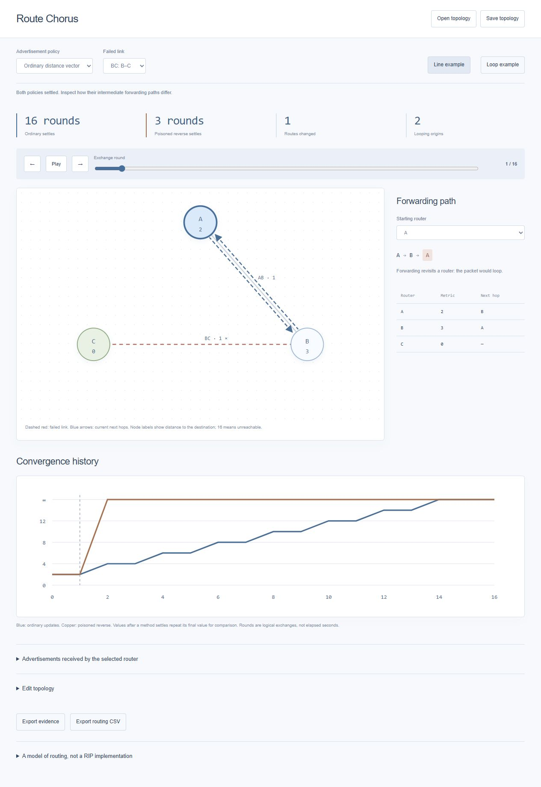
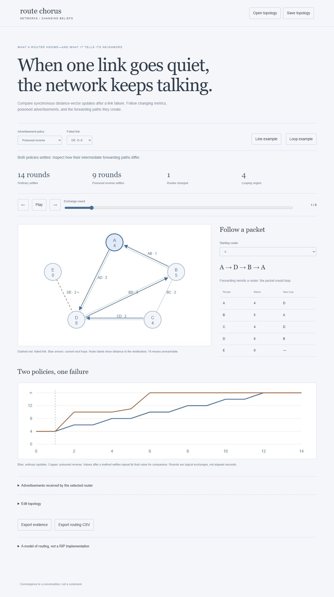

# Route Chorus

A distance-vector routing workbench comparing ordinary advertisements with poisoned reverse after a link failure. Inspect changing metrics, recipient-specific advertisements, and actual forwarding paths rather than treating convergence as an instantaneous event.



The topology uses animated directional dashes for current next-hop choices, distinct unreachable routers, and a chip-based forwarding path. The convergence cursor moves without rebuilding its history, router selection preserves keyboard focus, and reduced-motion settings stop the effects. The animation represents routing choices, not live packet traffic.

## Run

```sh
python run.py --port 8000
```

Open http://127.0.0.1:8000 in a browser supporting module workers. Python 3.10+ serves static assets; Node 22+ runs the dependency-free tests. Simulation stays local and sends no routing traffic.

## Explore

The line example starts with A–B–C and destination C, then fails B–C. Ordinary updates let A and B repeatedly believe the other can reach C, increasing metrics until the cap of 16. It settles after 16 exchanges; poisoned reverse settles after three, including the final unchanged confirmation round. Round one under ordinary updates shows A → B → A.

Switch policies, scrub or play the recorded rounds, and choose a starting router by selector, graph click, or keyboard. The routing table and received advertisements follow the selection. The metric-history chart compares both policies for that router; shorter traces hold their final value for alignment. Selecting **No failure** shows intact-topology convergence.

The five-router loop example demonstrates a limitation: after D–E fails, poisoned reverse still produces A → D → B → A at round one. In this model ordinary updates settle in 14 rounds and poisoned reverse in nine. [Topology JSON](docs/loop-topology.json).



Topology editing/import supports 2–8 unique uppercase router IDs, 0–28 simple undirected links, costs 1–9, a destination, and one failed-link ID or null. Duplicate links, self-links, missing endpoints, and invalid bounds are rejected. Files/editor input are limited to 50 KB. JSON exports contain both complete traces, all advertisements and forwarding inspections; CSV contains every method/round/router metric and next hop. Save topology exports the applied model, not an unapplied editor draft.

## Model

The destination always advertises distance zero. Other routers start at 16 (unreachable). The intact topology is synchronously updated until metrics and next hops stop changing. This converged table becomes post-failure round zero, retaining stale next hops across the removed link until a subsequent exchange updates them.

Each round sends a scalar distance for this single destination along every active directed adjacency. With poisoned reverse, a sender advertises 16 specifically to the neighbor currently chosen as its next hop. Other recipients receive its stored metric. A router recomputes the minimum of link cost plus each received value, capped at 16. Ties choose the first neighboring ID in the input node order; a metric of 16 has no next hop. Every router uses the previous round's state, and all new tables take effect together.

The replay stops on an unchanged metric/next-hop table or at 64 exchanges. The UI distinguishes a limit from convergence. Forwarding inspection separately walks the current next-hop graph and reports delivery, unreachable, a failed-link traversal, or a repeated router. Graph arrows omit the failed physical link, while round-zero forwarding can still explain that stale choice.

## Scope

This is a deterministic synchronous Bellman–Ford-style teaching model inspired by distance-vector routing, **not a RIP implementation**. It omits timers, asynchronous delivery, triggered updates, route aging/garbage collection, hold-downs, split-horizon omission, authentication, interface networks, and packet formats. Routes are to router identities, not IP prefixes. Metrics 16 or larger are deliberately unreachable even when a longer physical path exists.

Poisoned reverse is not a universal loop-prevention guarantee. Besides the explicit three-router example, simultaneous next-hop changes based on older advertisements can yield transient two-router loops in this synchronous model. Do not infer real-device timing or protocol conformance from the traces. Logical rounds are not elapsed seconds.

## Verification

```sh
npm test
npm run check
python -m unittest discover -s tests -v
```

Seven JavaScript tests check the line and three-router-loop fixtures, recipient-specific poisoning, forwarding classifications, cap/tie behavior, validation, and 300 random topologies against independently computed Floyd–Warshall post-failure shortest paths. Both policies' settled metrics and delivered path costs must agree with the capped oracle. A Python test checks static asset restrictions, Host validation, and HEAD behavior. CI runs Node 22/24 on Linux and Node 24 on Windows.

Browser checks covered policy changes, advertisements, end-of-replay, removal/recovery of failure, keyboard router selection, and exports. Independent Python replay verified every post-failure routing table and forwarding path/status/cost in the five-router example, plus all 125 exported CSV rows.

Protocol background: [RFC 2453](https://www.rfc-editor.org/rfc/rfc2453.html), sections 3.4.2–3.4.4, discusses distance-vector instability, poisoned reverse, and triggered updates. The simplified synchronous behavior and its differences are specified above.
